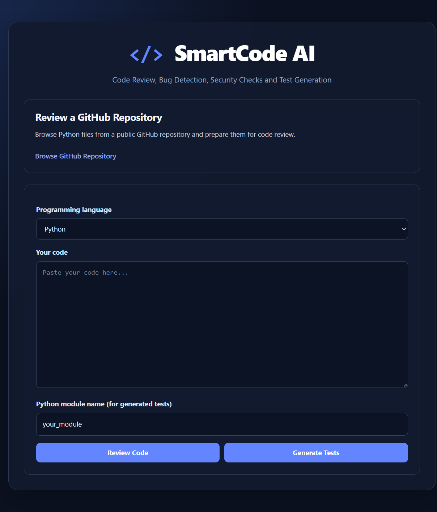
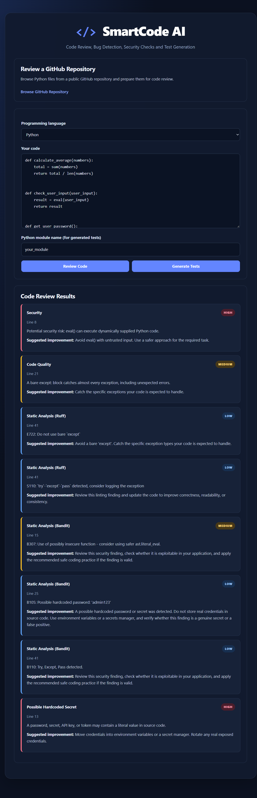
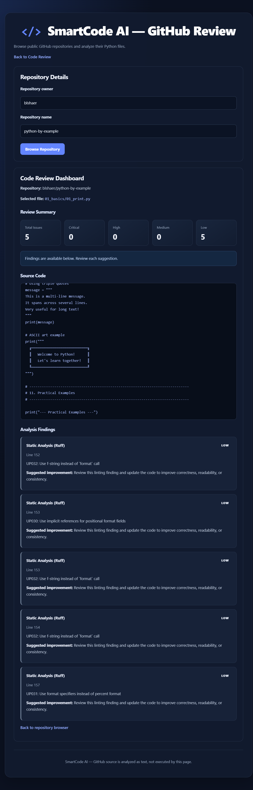

# SmartCode AI — Intelligent Code Review Platform


SmartCode AI is a Python-based code review platform that helps developers identify potential code-quality issues, inspect common security risks, review public GitHub repositories, and generate and run basic automated tests.

It combines static code analysis, heuristic security scanning, GitHub integration, test-generation workflows, and pull-request review automation in a Flask web application.

## Features

### 1. Code Review
- Submit source code for analysis.
- Review supported Python and Java code.
- View findings, severity levels, line numbers, and improvement suggestions.

### 2. Security Analysis
- Scan source code for selected security-risk patterns.
- Display potential security findings alongside code-review results.
- Provide suggestions for investigating possible vulnerabilities.

*Static security checks are heuristic-based. They may produce false positives or miss vulnerabilities and cannot guarantee that code is secure.*

### 3. GitHub Repository Review
- Retrieve eligible Python files from public GitHub repositories.
- Review individual source files.
- Inspect findings and suggestions for the selected files.

### 4. Batch Code Review
- Analyze multiple Python files.
- Review findings across selected files.
- View summary statistics for reviewed files, failures, and severity levels.

### 5. Automated Test Generation
- Generate basic pytest test code for supported Python functions.
- Review generated tests and the functions they cover.
- Copy or download generated test files.

### 6. Test Execution
- Run generated tests and display execution results.
- View passed, failed, and skipped test counts.
- Inspect available error messages and test output.

**Security note:** The current test runner is a local prototype, not a secure sandbox. Do not execute untrusted code or expose test execution publicly without appropriate isolation and resource limits.

### 7. Automated Pull-Request Review
- Identify changed Python files in a pull request.
- Analyze changes for code-quality and security findings.
- Separate findings on changed lines from other findings in reviewed files.
- Generate a Markdown review report.

The pull-request workflow uses Git and GitHub Actions. Review capabilities depend on the configured workflow and repository permissions.

## Technology Stack

- **Language:** Python
- **Web framework:** Flask
- **Frontend:** HTML, CSS, Jinja2 templates
- **Code analysis:** Custom analysis modules and supported static-analysis tools
- **Security scanning:** Custom static security scanner
- **GitHub integration:** GitHub repository retrieval and pull-request review workflow
- **Testing:** pytest
- **Code quality:** Ruff
- **Security checks:** Bandit and custom scanning rules
- **Version control and CI:** Git, GitHub, GitHub Actions

## Project Structure

```text
SmartCodeAI/
├── .github/
│   └── workflows/
├── docs/
├── screenshots/
├── static/
├── templates/
├── tests/
├── app.py
├── analyzer.py
├── security_scanner.py
├── finding_deduplicator.py
├── changed_line_filter.py
├── github_service.py
├── pr_review.py
├── post_pr_review.py
├── pr_review_demo.py
├── test_generator.py
├── test_runner.py
├── requirements.txt
├── requirements-dev.txt
└── README.md
```

This is a simplified view of the main project files; additional test and utility modules are included in the repository.

## Getting Started

### Prerequisites
- Python 3.11 or later
- pip
- Git

### 1. Clone the repository

```bash
git clone https://github.com/divyasingarapu/SmartCodeAI.git
cd SmartCodeAI
```

### 2. Create and activate a virtual environment

**Windows PowerShell:**

```powershell
python -m venv venv
.\venv\Scripts\Activate.ps1
```

**macOS or Linux:**

```bash
python -m venv venv
source venv/bin/activate
```

### 3. Install dependencies

```bash
python -m pip install -r requirements.txt
```

For development and testing tools, install:

```bash
python -m pip install -r requirements-dev.txt
```

### 4. Run the application

```bash
python app.py
```

Open the local address printed in the terminal. For a typical local Flask setup, this is:

```text
http://127.0.0.1:5000
```

Use the application locally unless you have configured appropriate production security controls.

## Running Tests and Quality Checks

Run these commands from the project root.

**Automated tests:**

```bash
python -m pytest -q
```

**Code quality:**

```bash
python -m ruff check .
```

**Security scan:**

```bash
python -m bandit -r .
```

Bandit results require manual review. Some warnings may be expected for reviewed subprocess or other security-sensitive operations; do not suppress findings without understanding the underlying risk.

## Pull-Request Review Workflow

The repository includes GitHub Actions workflow configuration and pull-request review scripts.

At a high level, the review process:

1. Identifies changed Python files.
2. Obtains the diff for the pull request.
3. Runs code-quality and security checks on eligible files.
4. Filters findings by changed line numbers.
5. Produces a Markdown review report.

Workflow behavior depends on the repository's GitHub Actions configuration, permissions, and available dependencies.

## Security Considerations

- Treat static-analysis results as guidance, not proof of security.
- Analyze untrusted source code as text whenever possible.
- Do not execute untrusted generated tests without proper isolation.
- Never commit credentials, access tokens, or private configuration files.
- Keep Flask debug mode disabled outside local development.
- Add operating-system or container isolation, timeouts, and resource limits before deploying code execution features publicly.

## Current Limitations

- Static checks may miss vulnerabilities or report false positives.
- Test generation supports only the function patterns implemented in the generator.
- GitHub review is limited to supported files and configured repository access.
- Production-grade sandboxing for test execution is not implemented.
- Automated review findings still require human verification.

## Future Improvements

- Expand language-aware parsing and analysis rules.
- Improve security coverage and reduce false positives.
- Generate tests for a wider range of function patterns.
- Add isolated test execution using containers or another suitable sandbox.
- Add review history, filtering, and exportable reports.
- Expand CI coverage and integration testing.

## Screenshots

### Home Dashboard



### Code Review Dashboard



### GitHub Repository Review



## Author

**Singarapu Divya**

B.Tech — Computer Science and Engineering
Lendi Institute of Engineering and Technology
